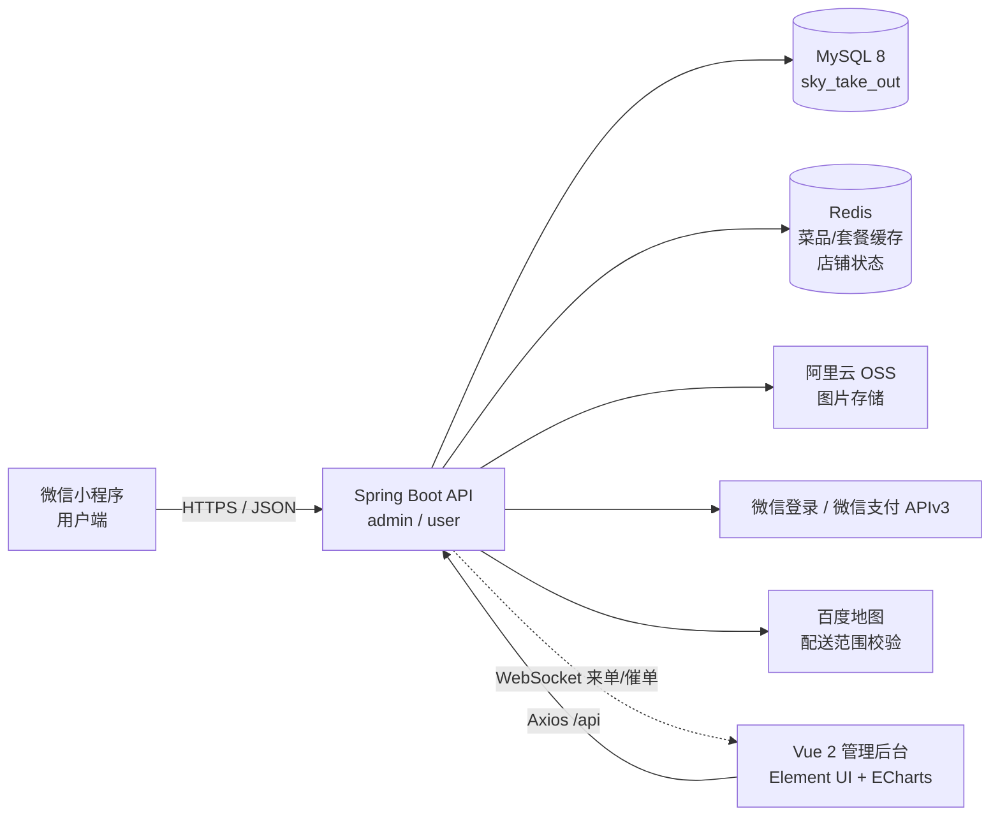

<h1 align="center">苍穹外卖 · Sky Take Out</h1>

<p align="center">
  <strong>微信小程序点餐 + Vue 管理后台 + Spring Boot 服务端</strong><br/>
  覆盖「浏览 → 加购 → 下单 → 支付 → 接单 → 配送 → 统计 → 报表」的完整外卖业务闭环
</p>

<p align="center">
  
  
  
  
  
  
  
  
  
</p>

---

## 📖 项目简介

**苍穹外卖**是一个前后端分离的外卖 O2O 全栈项目，包含三个端：

- **用户端（微信小程序）**：微信登录、菜品/套餐浏览、购物车、收货地址、下单支付、历史订单、订单详情。
- **商家管理端（Vue 2 + TypeScript）**：员工、分类、菜品、套餐、订单、店铺状态、工作台、数据统计与 Excel 报表导出。
- **服务端（Spring Boot 4）**：REST API、JWT 双端鉴权、Redis 缓存、WebSocket 实时提醒、定时任务、AOP、对象存储、接口文档。

业务模型参考《苍穹外卖》课程，代码用于个人学习与作品展示。

## 🚀 技术栈

### 后端

| 分类 | 技术 | 版本 | 用途 |
| --- | --- | --- | --- |
| 运行时 | **Java** | **25** | 语言与运行环境 |
| 核心框架 | **Spring Boot** | **4.1.1** | 自动装配、依赖管理、内嵌容器 |
| Web 层 | **Spring MVC**（Spring Framework 7） | — | RESTful API、拦截器、全局异常 |
| 持久层 | **MyBatis** + MyBatis Spring Boot Starter | 4.0.0（Starter） | SQL 映射、动态 SQL |
| 数据库 | **MySQL** | 8.0+ | 业务数据存储 |
| 缓存 | **Redis** + Spring Data Redis + Spring Cache | 6+ | 菜品/套餐缓存、店铺营业状态 |
| 连接池 | **Druid** | 1.2.28 | 数据源与监控 |
| 分页 | **PageHelper** | 4.1.1 | 物理分页 |
| 鉴权 | **JJWT** | 0.12.7 | JWT 生成与校验 |
| 接口文档 | **Knife4j** + SpringDoc | 4.5.0 / 3.0.3 | OpenAPI 3 文档与调试 |
| 实时通信 | **Spring WebSocket** | — | 来单提醒、催单提醒 |
| 切面 | **Spring AOP / AspectJ** | — | 公共字段自动填充 |
| 报表 | **Apache POI** | 5.5.1 | Excel 模板填充与导出 |
| 支付 | **微信支付 APIv3 SDK** | 0.4.8 | 预下单、退款封装 |
| 对象存储 | **阿里云 OSS SDK v2** | 0.5.1 | 菜品/套餐图片上传 |
| JSON | **Fastjson2** | 2.0.65 | 微信接口报文与 WebSocket 消息 |
| 工具 | **Lombok** / Apache HttpClient5 | 1.18.48 / — | 简化实体、HTTP 调用 |
| 构建 | **Maven** | 3.9+ | 多模块聚合构建 |

### 管理端

| 分类 | 技术 | 版本 |
| --- | --- | --- |
| 框架 | **Vue** | 2.7.16 |
| 语言 | **TypeScript** | 4.9.5 |
| UI 组件 | **Element UI** | 2.15.14 |
| 路由 | **Vue Router** | 3.6.5 |
| 状态管理 | **Vuex** | 3.6.2 |
| HTTP | **Axios** | 1.7.9 |
| 图表 | **ECharts** | 5.6.0 |
| 构建 | **Vue CLI / Webpack** | 5.0.9 / 5 |
| 样式 | **Sass** | 1.77.8 |
| 测试 | **Jest** + Vue Test Utils | 27.5.1 / 1.3.6 |
| 装饰器 | vue-class-component / vue-property-decorator | 7.2.6 / 9.1.2 |
| 工程化 | PWA、ESLint、Prettier、Babel | — |

### 小程序与数据层

| 分类 | 技术 | 说明 |
| --- | --- | --- |
| 用户端 | **微信小程序** | WXML / WXSS / JavaScript |
| 组件库 | **uni-ui** | popup、icons、nav-bar 等 |
| 构建来源 | **uni-app** | 当前目录为编译后的微信小程序产物 |
| 数据库 | **MySQL 8** | 11 张业务表，见 [`数据库设计文档`](数据库/数据库设计文档.md) |

> **一句话技术栈**：`Java 25` · `Spring Boot 4` · `MyBatis` · `MySQL` · `Redis` · `JWT` · `WebSocket` · `AOP` · `Knife4j` · `Apache POI` · `Vue 2.7` · `TypeScript` · `Element UI` · `ECharts` · `Vuex` · `Axios` · `Sass` · `微信小程序`

## ✨ 功能概览

### 用户端（微信小程序）

- 微信授权登录，JWT 无状态会话
- 菜品分类、菜品列表、套餐列表、菜品详情与口味选择
- 购物车：加购、减购、清空
- 收货地址：新增、编辑、删除、设置默认地址
- 提交订单、订单备注、模拟支付
- 历史订单、订单详情、再来一单
- 店铺营业状态展示

### 商家管理端（Vue）

- **员工管理**：登录、分页查询、新增、编辑、启用/禁用
- **分类管理**：菜品分类、套餐分类的增删改查与排序
- **菜品管理**：图片上传、口味配置、起售/停售、批量删除
- **套餐管理**：套餐与菜品关联、起售/停售、缓存清理
- **订单管理**：条件搜索、接单、拒单、派送、完成、取消、退款
- **店铺管理**：营业 / 打烊状态切换
- **工作台**：今日营业额、有效订单、订单完成率、平均客单价、新增用户
- **数据统计**：营业额、用户、订单、销量 Top10，ECharts 可视化
- **运营报表**：按最近 30 天填充 Excel 模板并导出
- **实时提醒**：WebSocket 来单提醒、客户催单

### 服务端能力

- 统一响应体 `Result<T>` 与分页结果 `PageResult`
- 全局异常处理（业务异常、唯一键冲突）
- JWT 双拦截器：`/admin/**` 与 `/user/**` 分开鉴权
- `ThreadLocal` 保存当前登录用户/员工 ID
- AOP + 自定义注解自动填充创建人、创建时间、修改人、修改时间
- Redis 缓存菜品与套餐，更新时精准失效
- 定时任务：超时未支付订单自动取消、派送中订单自动完成
- 百度地图配送范围校验（未配置 AK 时自动跳过）
- 阿里云 OSS 图片上传
- Knife4j 在线接口文档

## 🏗️ 系统架构



后端采用经典三层结构，并按职责拆分为 Maven 多模块：

```text
Controller  →  Service  →  Mapper  →  MySQL
     ↑            ↓
  JWT 拦截器    Redis / OSS / 微信 / 百度地图
```

## 📂 项目结构

```text
sky-takeout/
├── sky-takeout-backend/                  # 后端服务（Maven 多模块）
│   ├── sky-common/                       # 通用层：Result、异常、常量、JWT、OSS、微信支付工具
│   ├── sky-pojo/                         # 数据模型：Entity / DTO / VO
│   ├── sky-server/                       # 服务层：Controller / Service / Mapper / 配置 / 定时任务
│   │   └── src/main/resources/
│   │       ├── application.yml            # 公共配置
│   │       ├── application-dev.yml        # 本地开发配置（已脱敏）
│   │       ├── mapper/                    # MyBatis XML
│   │       └── template/                  # Excel 报表模板
│   └── pom.xml
├── front_end/
│   └── project-sky-admin-vue-ts/         # 管理端（Vue 2 + TypeScript + Element UI）
│       ├── src/api/                      # 接口封装
│       ├── src/views/                    # 页面：工作台、订单、菜品、套餐、统计等
│       ├── src/router.ts                 # 路由与权限
│       └── src/store/                    # Vuex
├── 小程序/                                # 用户端（微信小程序 / uni-app 编译产物）
│   ├── pages/                            # 首页、订单、支付、地址、我的等
│   ├── components/                       # uni-ui 组件
│   └── common/vendor.js                  # 接口 baseUrl 配置位置
├── 数据库/
│   ├── sky.sql                           # 建库、建表与初始化数据
│   └── 数据库设计文档.md                  # 11 张表结构说明
├── .gitignore
├── .gitattributes
└── README.md
```

## 🚀 快速开始

### 环境要求

| 依赖 | 版本 |
| --- | --- |
| JDK | **25**（`pom.xml` 中 `java.version=25`） |
| Maven | 3.9+ |
| MySQL | 8.0+ |
| Redis | 6+ |
| Node.js / npm | 18.12+ / 9+（推荐 Node 20 LTS） |
| 微信开发者工具 | 最新稳定版 |

### 1. 克隆项目

```bash
git clone https://github.com/lvanning/sky-takeout.git
cd sky-takeout
```

### 2. 初始化数据库

```bash
mysql -u root -p < 数据库/sky.sql
```

Windows PowerShell 不支持 `<` 重定向，可改用：

```powershell
Get-Content .\数据库\sky.sql -Raw | mysql -u root -p
```

默认配置使用 `skyUser / skypswd123` 连接 `sky_take_out`，可创建对应账号：

```sql
CREATE USER 'skyUser'@'localhost' IDENTIFIED BY 'skypswd123';
GRANT ALL PRIVILEGES ON sky_take_out.* TO 'skyUser'@'localhost';
FLUSH PRIVILEGES;
```

也可以直接修改 `application-dev.yml` 中的 `username` / `password` 为本机 MySQL 账号。

### 3. 启动 Redis

确保 Redis 已启动，默认配置为 `localhost:6379`、密码 `123456`、数据库 `10`。如与本机不一致，请修改 `application-dev.yml`。

### 4. 启动后端

```bash
cd sky-takeout-backend
mvn clean package -DskipTests
java -jar sky-server/target/sky-server-1.0-SNAPSHOT.jar
```

启动成功后：

| 服务 | 地址 |
| --- | --- |
| 后端 API | `http://localhost:8080` |
| Knife4j 接口文档 | `http://localhost:8080/doc.html` |
| WebSocket | `ws://localhost:8080/ws/{sid}` |

### 5. 启动管理端

```bash
cd front_end/project-sky-admin-vue-ts
npm install
npm run serve
```

访问 `http://localhost:8888`，默认管理员账号：

```text
用户名：admin
密  码：123456
```

开发环境下 `/api` 会代理到 `http://localhost:8080/admin`，配置见 `.env.development`。

### 6. 运行小程序

1. 用微信开发者工具导入 `小程序/` 目录。
2. 在 `common/vendor.js` 中搜索 `var baseUrl =`，改成你的后端地址（默认 `http://localhost:8080`）。
3. 本地调试时勾选「不校验合法域名、web-view（业务域名）、TLS 版本以及 HTTPS 证书」。
4. `project.config.json` 中的 AppID 为课程示例 AppID，建议替换成你自己的小程序 AppID。

> `小程序/` 当前是 **uni-app 编译后的微信小程序产物**，可直接导入开发者工具运行；如果要做源码级修改，建议保留/恢复对应的 uni-app 源码工程后重新编译。

## ⚙️ 配置说明

核心配置文件：`sky-takeout-backend/sky-server/src/main/resources/application-dev.yml`

| 配置项 | 说明 |
| --- | --- |
| `sky.datasource.*` | MySQL 地址、库名、账号、密码 |
| `sky.redis.*` | Redis 地址、密码、database |
| `sky.jwt.admin-secret-key` / `user-secret-key` | JWT 签名密钥，生产环境务必更换 |
| `sky.jwt.admin-ttl` / `user-ttl` | Token 有效期（毫秒） |
| `sky.baidu.ak` | 百度地图开放平台 AK；为空时跳过配送范围校验 |
| `sky.wechat.appid` / `secret` | 微信登录；`secret` 已替换为占位符 |
| `sky.wechat.mchid` 等 | 微信支付商户配置，默认未启用 |
| `sky.alioss.*` | 阿里云 OSS 配置，图片上传需要有效凭证 |

> ⚠️ 公开仓库中的百度地图 AK、微信 AppSecret 已脱敏为 `your-baidu-map-ak`、`your-wechat-appsecret`。运行相关功能前请填入自己的密钥，**不要将真实密钥提交到 Git**。

## 🔌 接口文档

后端集成 **Knife4j（OpenAPI 3）**，启动后访问：

```text
http://localhost:8080/doc.html
```

接口按端划分：

- `/admin/**`：管理端接口，请求头携带 `token`
- `/user/**`：用户端接口，请求头携带 `authentication`

主要模块：员工、分类、菜品、套餐、购物车、地址簿、订单、支付、店铺、工作台、数据统计、报表导出、文件上传。

## 🧠 技术亮点

| 亮点 | 实现方式 |
| --- | --- |
| **多模块分层** | `sky-common` / `sky-pojo` / `sky-server` 职责清晰，依赖单向 |
| **JWT 双端鉴权** | 管理端与用户端独立拦截器、独立密钥与 Token 名称 |
| **登录上下文** | `ThreadLocal` 保存当前用户 ID，Service 层随取随用 |
| **缓存设计** | 菜品按分类手工缓存 `dish_{categoryId}`；套餐使用 Spring Cache `setmealCache`，更新时精准清除 |
| **AOP 自动填充** | 自定义 `@AutoFill` 注解 + 反射，统一维护创建人/时间、修改人/时间 |
| **实时提醒** | WebSocket `/ws/{sid}` 广播来单、催单消息，管理端实时弹窗 |
| **定时任务** | 每分钟取消超时 15 分钟未支付订单；每天凌晨处理超时派送订单 |
| **Excel 报表** | POI 读取模板，填充最近 30 天营业额、订单、客单价、新增用户等数据 |
| **数据可视化** | 营业额 / 用户 / 订单 / 销量 Top10 统计接口 + ECharts 折线图、柱状图 |
| **统一异常处理** | `@RestControllerAdvice` 捕获业务异常与唯一键冲突，返回统一 `Result` |
| **配送范围校验** | 百度地图地理编码 + 驾车路线距离，超过店铺配送范围时拦截下单 |
| **对象存储** | 阿里云 OSS SDK v2 上传菜品/套餐图片，返回可访问 URL |

## 📝 已知说明

- **支付为模拟流程**：`OrderServiceImpl.payment()` 中真实微信预下单代码默认注释，当前调用后直接将订单置为已支付，便于本地跑通「下单 → 接单」闭环。真实支付需配置商户号、API v3 密钥、商户私钥与平台证书，并恢复预下单的注释代码；退款接口同样依赖这些商户配置。
- **小程序为编译产物**：当前仓库未包含 uni-app 源码，接口地址需在 `common/vendor.js` 中修改；长期维护建议补充源码工程。
- **外部服务可选**：百度地图 AK 为空时会跳过配送范围校验；OSS 未配置凭证时图片上传不可用；微信登录需要有效 `appid` / `secret`。
- **配置已脱敏**：公开仓库不包含真实第三方密钥，请使用自己的账号配置。

## 🙏 致谢

- 业务模型参考《苍穹外卖》课程。
- 管理端基于 [vue-typescript-admin-template](https://github.com/Armour/vue-typescript-admin-template) 二次开发，原项目 LICENSE 见 [`front_end/project-sky-admin-vue-ts/LICENSE`](front_end/project-sky-admin-vue-ts/LICENSE)。
- 小程序使用 [uni-ui](https://uniapp.dcloud.net.cn/component/uniui/uni-ui.html) 组件库。

## 📄 说明

本项目仅用于学习交流与作品展示，请勿直接用于商业用途。
